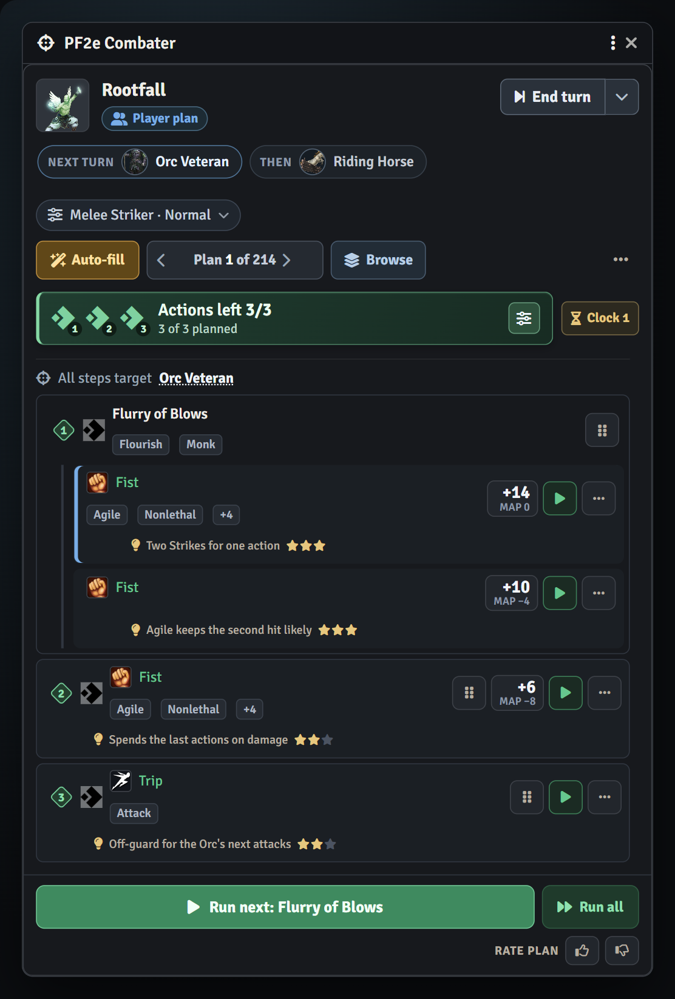
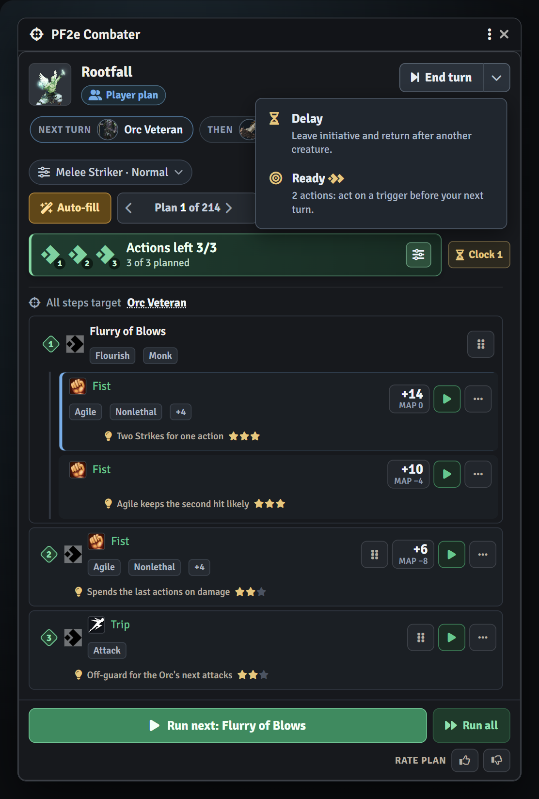
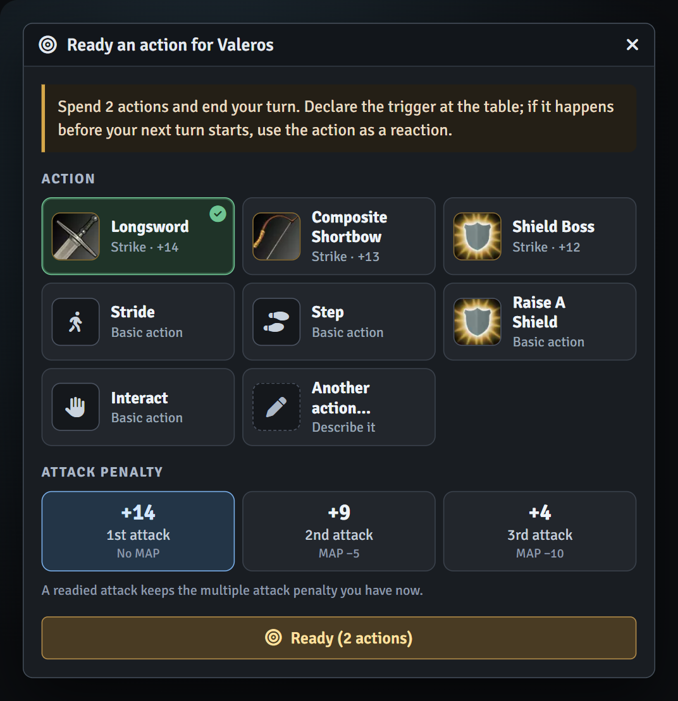
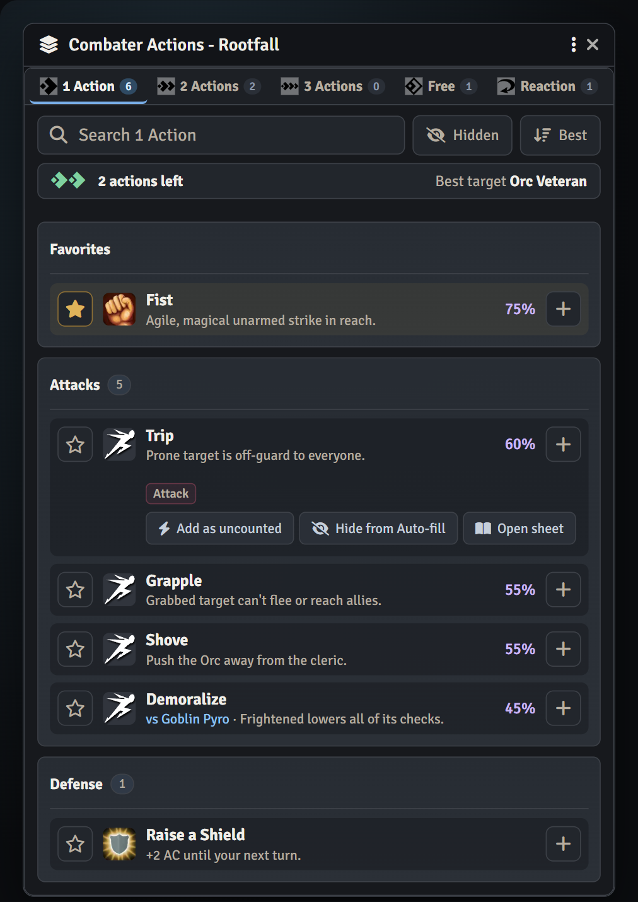
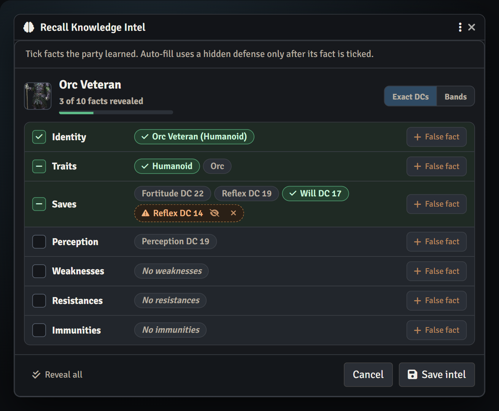
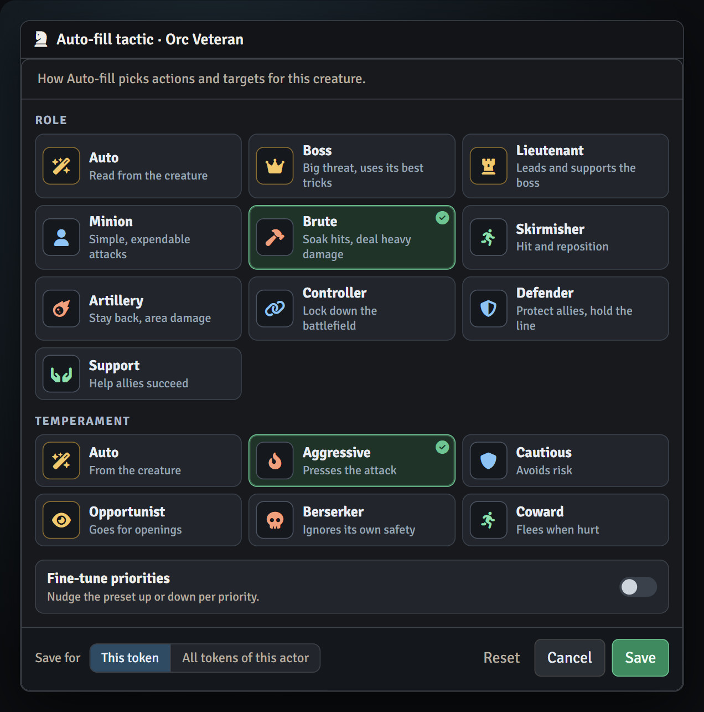
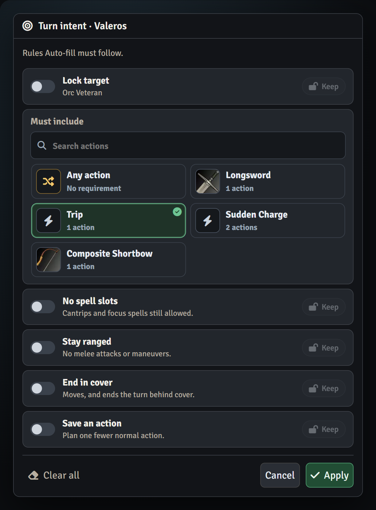
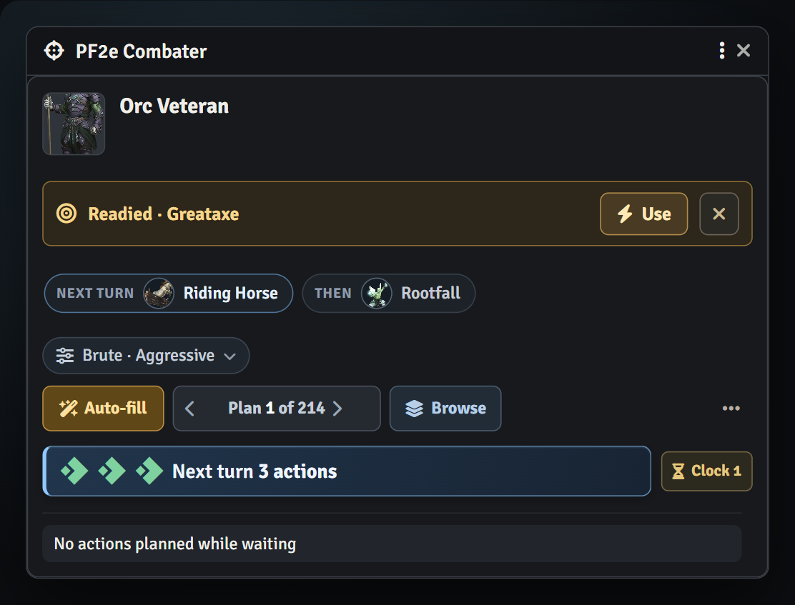
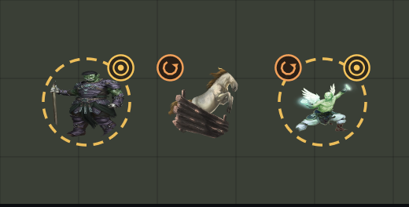

# PF2e Combater – Tactical Turn Planner And Executioner

[](https://github.com/roi007leaf/pf2e-combater/releases/latest)
[](https://github.com/roi007leaf/pf2e-combater/releases)

PF2e Combater is a floating combat advisor for Foundry VTT's Pathfinder 2e system. It reads the
acting creature's real options — strikes, spells, feats, generic actions — together with the
battlefield around it, and helps you **plan a whole turn, see it on the canvas, and execute it step
by step** (with one-click undo). It also **tracks the actions you actually spend** — from chat cards,
rolls and token movement — and handles **End turn, Delay and Ready** from the same window. GMs get
tactical recommendations for the creatures they run; players plan their own turns.

[](https://ko-fi.com/roileaf)
[](https://www.patreon.com/roileaf)

<p align="center"></p>

## 🆕 What's new in 2.0

- **Live action tracking.** Actions left updates from PF2e chat cards, action rolls, Combater
  execution and token movement on the canvas. Slowed, stunned (Spring 2026 errata) and quickened shape
  the budget automatically.
- **End turn, Delay and Ready** right in the panel. Ready an action with a card picker, keep your MAP,
  pick a Stride destination, and use it later as a reaction — with markers on the token.
- **A redesigned interface.** Numbered steps matched to action diamonds, real attack bonuses,
  Run next / Run all, a one-line action browser with success chances, and reworked Intel, Tactic,
  Turn Intent, Loadout and Effect Clock windows. Dropdowns became image card pickers.

See the [changelog](CHANGELOG.md) for everything in each release.

## 🖼️ Screenshots

| | |
|:-:|:-:|
| <br>**End turn · Delay · Ready** | <br>**Ready an action** |
| <br>**Action browser** | <br>**Recall Knowledge Intel** |
| <br>**NPC tactic** | <br>**Turn intent** |
| <br>**Readied action & next-turn forecast** | <br>**Token markers: readied · reaction used** |

<details>
<summary>Canvas and 1.x screenshots</summary>


</details>

---

## 🧭 The panel at a glance

- **Header.** Portrait, name, **Player plan** and **Reaction used** badges, and **End turn ▾**
  (Delay, Ready). A compact **turn-order strip** shows who acts next; click a creature to pan to it.
- **Plan setup.** One dropdown holds Tactic, resource use (Conserve / Normal / Burst), Intel, Intent
  and Loadout. **Auto-fill** builds a turn; **‹ Plan N of M ›** steps through the next-best plans
  (Shift-click Auto-fill to rebuild from scratch). **Browse** opens the action browser.
- **Budget bar.** The PF2e action diamonds carry step numbers, so you can see which actions each
  step uses — hover a step to light its diamonds. "N of M planned" warns when a plan overspends.
  The **Adjust** popover holds the spend/refund controls; **Clock** opens timed effects.
- **Plan.** Steps are numbered. Strikes show their **attack bonus** with MAP underneath (click to
  pin a MAP level). Decision traits (Agile, Nonlethal, Reach…) stay inline and the rest collapse
  into a "+N" chip. A target every step shares is shown once above the plan. Each step's top reason
  comes with 1–3 stars. Target, weapon, movement type, route, duplicate and remove live behind **⋯**.
- **Footer.** **Run next** executes the next step; **Run all** runs the rest in order and stops at the
  first step that needs a choice, waits for the GM, or fails. Thumbs up/down rate the plan.

## ⏳ Turns: action tracking, End turn, Delay & Ready

### Action tracking

During the selected combatant's turn, **Actions left** tracks recognized PF2e chat cards and action
rolls alongside actions executed through Combater, and Auto-fill and Browse plan against what's
left. Damage rolls, saving throws, rerolls, free actions and reactions spend nothing. Cards posted
for reference still count: use the **Adjust** popover to refund them or to spend an action that was
not posted. Deleting a standalone tracked card removes its spend. Receipts survive panel closes and
reloads.

**Canvas movement spends actions too**, using Foundry's recorded path cost and the actor's Speed —
at Speed 25, a 35-foot Stride costs two actions. Terrain and diagonals use the native cost;
continuing the same path shares its allowance, a new path starts another movement action, and
native movement undo refunds it. Combater-executed movement and matching movement cards count once;
displacement and teleports don't count as Strides.

Outside its turn, a creature's tracker shows **Next turn** with the expected action total, and
Auto-fill plans against that forecast.

### Conditions & Quickened

The turn-start pool accounts for **slowed, stunned and quickened**; slowed and stunned overlap and the
restricted quickened action is lost first. **Stunned follows the Spring 2026 errata**: newly applied
valued stunned waits for a Combater activity in progress to finish, then spends remaining actions
(quickened first) and reduces its value by the actions actually lost; only unpaid stunned carries
into the next turn. Haste gained mid-turn shows **Quickened · next turn**, and Auto-fill can add one
allowed recommendation for it.

An active Haste effect automatically allows **Strike** or **Stride**. For other sources the GM clicks
**Set actions** and toggles the allowed actions as cards (Strike, Stride, Step, Raise a Shield,
Interact, Sustain and the creature's own single actions), with a field for anything unusual. The choice
stays with that Quickened condition; players can spend and refund but not change it. The extra action
never pays for a multi-action activity.

### End turn & Delay

**End turn** advances the current combatant through Foundry's normal turn handling — owners end their
own turn, the GM any active turn. The **▾** beside it opens **Delay** and **Ready**, and each says in
place why it's unavailable. **Delay** works at turn start before actions are spent: choose a creature
to return after (earlier turns are marked **next round**); Combater moves initiative, advances combat,
and keeps your plan and remaining actions for the return. The GM can **Bring in now** any waiting
creature. PF2e's turn effects run once. Player turn controls need socketlib and a connected GM.

### Ready

**Ready** (2 actions) prepares a single action and ends the turn. Pick it from cards with its art:
your Strikes (each showing its bonus), Stride, Step, Raise a Shield, Interact, a **skill action**
(Trip, Grapple, Shove, Demoralize, Create a Diversion, Recall Knowledge, Seek, Hide, Take Cover and
more, with a search box), or another action you type. Disarm and Feint appear once you're trained. A
readied Strike keeps the multiple attack penalty you had, shown as three cards with your real bonus at
each step, and a readied skill action rolls the real PF2e check when you use it. Declare the trigger at
the table. Fleeing and Confused prevent Ready.

- The token shows an **amber ring and bullseye** until the creature's next turn, and the panel shows
  **Readied · <action>** with **Use** and **Discard**.
- A readied **Stride or Step** asks for its destination on the canvas, with the same reachable area
  and path preview as planned movement. Hover the banner to preview the route; **⌖** changes it.
- **Use** rolls a readied Strike at its stored MAP, or moves the token along the readied route, and
  **spends the creature's reaction**: the token gets an orange **↺ badge** and the panel shows
  **Reaction used** until its next turn. Reactions recorded by PF2e Reaction Checker or Sundry count
  too, and Combater updates both modules when it spends one.
- Markers are visible to everyone for player characters and only to the GM for GM creatures.

## Combat options without the panel

GMs can enable **Large creature flanking rule**, **Raise PC shields when Defending**, and
**Enrage barbarians at combat start** in Foundry's PF2e Combater module settings. These world
settings work without opening the Combater panel or using its planner. Set **Auto-open on turn
start** to off on each client that should keep the panel closed.

Shield raising requires a PC with the Defend exploration activity and a usable held shield.
Rage requires Quick-Tempered and a Rage action with a configured self-applied effect. If PF2e
Avoid Notice already handles either action, Combater leaves that action to it. Existing Visioner
combat-option settings transfer once when both modules are active; Visioner's old values reset
to their defaults to prevent duplicate automation.

---

## ✨ What it does

- **Auto-fill.** One click builds a sensible turn from the highest-value actions and fits it to the
  action economy — moving into reach, attacking, casting, or repositioning as the situation calls
  for. Shift-click to discard the current draft and rebuild from scratch. **‹ Plan N of M ›** cycles
  through the next-best ranked alternatives — the rest of this doc calls that **Shuffle**. One
  projected plan state follows position, MAP, conditions, shields, targets, durations and resources
  through every step. Filling around manual choices continues their MAP and Strike count, and
  remembers immediate-action and target-condition setups.
- **Resource horizons.** Choose **Conserve, Normal or Burst** in the plan-setup dropdown before
  Auto-fill. Conserve protects scarce slots, consumables and limited uses; Burst spends more freely as
  encounter pressure rises. The choice is local to your client. During search, Auto-fill reserves each
  shared resource pool, so a plan never spends the same slot, focus point, consumable or use twice.
- **Real action sources.** Options are read from the actor itself, not a fixed list:
  - **Strikes** (melee and ranged), with the multiple attack penalty accounted for — and a MAP button
    on each Strike to pin a level when an ability keeps MAP flat across attacks.
  - **Spells** — curated catalog plus inferred classification (damage, save, area, control, healing,
    buff…), respecting slots, focus points, and prepared/spontaneous/innate entries. Wands, scrolls
    and spell gems show up as real castable actions, tracked against their own charges or quantity.
  - **Generic & skill actions** (Stride, Step, Demoralize, Trip, Grapple, Recall Knowledge, …), gated
    by whether they're usable right now.
  - **Class & system feats/actions** detected from the actor's items.
- **Action browser.** Tabs per action cost with counts, search across every tab, and one line per
  action with its reason and a **success-chance column**. One budget line replaces per-row warnings,
  and the shared best target is shown once. Click a row for details, **Add as uncounted**, **Hide from
  Auto-fill** and **Open sheet**; sort by **Best** or **A–Z**.
- **Move-and-strike composites.** When a target is a stride or two away, the planner offers
  "Stride → Strike" (and "Stride → Stride → Strike") plays, with the destination computed to land in
  reach — plus Step-first and Stand-first variants, and Stride into a multiattack ability.
- **Positional tactics (GM NPCs).** Recommends **Skirmish/Kite** (optional melee → stride out of
  threat → ranged Strike or offensive spell) and **Flank-and-Strike** when the situation favors them.
- **Situational remedies.** Condition responses appear only when they apply — Stand / Crawl while
  prone, Retch while sickened (the GM sets the Fortitude DC, the player rolls, and the GM rules over a
  synced "waiting for the GM" hand-off), Escape while grabbed/restrained.
- **Action favorites.** Star an action in the browser to pin it into Favorites, and drag to reorder —
  saved per user, per actor.
- **Hidden actions.** **Hide from Auto-fill** hides an action from player Browse and player Auto-fill
  for that actor. GMs see **Hidden for players** and can still use it; the **Hidden** toggle reveals
  hidden actions for restoring. Existing draft steps stay intact.
- **Summon planning.** With PF2e Summons Assistant active, supported creature summon spells get a
  **Choose summon** button. Pick the creature and placement before casting; Summons Assistant reuses
  them without reopening its picker. Reverting a cast requires manually removing the summoned token.
- **Uncounted actions.** Multi-step activities such as Sudden Charge's Stride-Stride-Strike run
  alongside the main plan without spending the 3-action budget, and each still executes and reverts
  independently.
- **Weapon & position handling.** Draw, **Sheathe**, Release (drop), Reload, and **Swap Items** (pick
  what to put away and what to draw from item cards); a 1-action Drop Prone when it helps.
- **Loadout advisor.** Suggests gear swaps for the current battlefield, with the best one marked, and
  adds the swap to the plan in one click.
- **Effect clock.** Timed effects and conditions grouped into **This turn** and **Later**.
- **GM aggro targeting.** For GM-run NPCs, the planner weighs which player character is the best
  target (healer, caster, controller, defender, low HP) and pre-picks it.
- **GM tactic personalities.** NPCs get a role (Boss, Lieutenant, Minion, Brute, Skirmisher,
  Artillery, Controller, Defender, Support) and a temperament (Aggressive, Cautious, Opportunist,
  Berserker, Coward), picked from cards with a one-line description of each. **Fine-tune priorities**
  nudges individual action and target priorities on −3…+3 scales (Avoid · Preset · Prefer). Auto-fill
  and Shuffle use that profile when ranking actions and choosing targets.
- **Player tactic roles.** Characters get PC-facing roles — Melee Striker, Ranged Striker, Spell
  Damage, Healer, Buffer, Debuffer, Defender, Support and Skirmisher. A role changes which whole plans
  Auto-fill and Shuffle prefer, not just individual action scores. Players don't get the NPC-only
  roles, temperament or fine-tuning.
- **Turn intent.** Rules Auto-fill must follow this turn: lock the target, require an action (searchable
  cards), no spell slots, stay ranged, end in cover, or save an action. **Keep** carries a rule into
  later turns until the encounter ends.
- **Recall Knowledge Intel.** Players roll one secret d20 to attempt Recall Knowledge; the GM sees the
  degrees of success across every applicable skill/Lore DC and chooses the outcome, then ticks the
  facts revealed — traits, save DCs, weaknesses, resistances and immunities — as **exact DCs** or
  level-scaled **bands**. Each category is one row with a select-all box and a revealed-facts progress
  bar. Players see every topic, with unknown ones marked, and Player Auto-fill/Shuffle use revealed
  Intel but never unrevealed defenses.
- **Intel misinformation.** **+ False fact** on a category row plants a wrong fact (a fake Reflex DC,
  trait, weakness…) as an orange chip beside the real ones; the GM can show or hide it, and a Critical
  Failure can reveal prepared misinformation instead of the real fact. Players see it as ordinary
  truth; Auto-fill, Best target and scoring only ever use real facts.
- **Bestiary Tracking integration.** With an active Bestiary Tracking release exposing the v1
  knowledge API (including fork 1.3.11), Auto-fill and Shuffle also use shared party knowledge:
  revealed traits, numeric saves and Perception, IWR, and known Reactive Strike. Revealed numeric
  AC supports attack preflight estimates. Hidden fields and vague/custom text provide no numeric
  estimates, and existing Combater Intel takes precedence for overlapping facts.
- **Plan preference learning.** Thumbs-up/down a plan to teach Auto-fill and Shuffle which complete
  turn sequences you like. Ratings are local per user and actor and give a capped, predictable nudge
  — they never touch actor data or PF2e rules.
- **Native Roll-Context Preflight.** Supported actions show what PF2e's live check context would say
  before you roll — hit/success chance or the named check modifier — using only target information
  you're allowed to know. GMs always see it; showing it to players is an opt-in world setting.
  Disclosed odds give Auto-fill a bounded adjustment that values critical outcomes, basic saves,
  risky failures and incapacitation; approximate revealed Intel receives half weight.
- **Best target.** Each scored action names the combatant scoring picked for it. A normal target
  button click uses your current Foundry target; Shift-click commits the scored best target.
- **Companion/minion support.** Command an Animal appears when a commandable companion, familiar or
  minion is detected, and its recommendation can show the two-action minion subturn it sets up.

## 🎯 On the canvas

- **Movement preview** for strides: the path, reachable squares, the starting square and the landing
  square — clamped to the creature's actual Speed and the scene's diagonal rule.
- **Choose the movement type.** When a creature has more than one Speed, a Stride can travel on
  **fly, burrow, swim or climb** — the chosen speed sizes the reachable range and is the movement
  the token uses on execute.
- **Tactical routes.** Cycle a Stride between **Approach, Shortest, Safest, Seek Cover, Flank and
  Escape**. The route scorer weights melee threats and open enemy lines by each segment's movement
  cost; Foundry/PF2e still measures and executes the final route through its native movement.
- **Vertical movement** for fly and burrow: hold **Shift** and scroll while placing a waypoint to
  raise or lower it. Each waypoint keeps its own height, and every leg's vertical distance counts
  against Speed.
- **Teleport destinations.** Translocate and other teleports show a **range ring** and let you click
  the target space; executing repositions the token instantly, and reverting returns it.
- **Range and area overlays** when hovering ranged or template spells. When an action has several
  areas, pick the shape from cards (cone, line, burst…).
- **Area templates with auto-expiry.** A lingering area (cloud, wall, darkness) creates a linked PF2e
  countdown effect on the caster and removes the template automatically when the duration ends.
- **Turn markers.** A readied action draws an amber ring and bullseye on the token; a spent reaction
  draws an orange ↺ badge.

## ▶️ Execute & undo

- Run the plan **step by step** with ▶ on each step, or use **Run next** / **Run all** in the footer.
  Strikes read your current target; moves go to the planned destination; spells cast through the
  system.
- **Drag to reorder** a planned step — grouped composites move as one block — or **duplicate** it
  (including its target, weapon and MAP overrides) from the step's **⋯** tools.
- **Revert** a completed step's real effect — movement returns the token, Stand re-applies prone,
  area actions delete their template — and **Reset** undoes the whole turn in reverse. Effects that
  can't be safely auto-undone are flagged for manual cleanup.
- Undo is conflict-aware: if movement, a spell slot, a consumable, frequency, reload state or carry
  state changed again after Combater used it, Revert leaves the newer value intact and reports it.

## 👥 Players & GM

- Players plan and execute their own combatant; the GM window follows the **selected token**.
- Players can **share** their draft with the GM, who can execute it on their behalf if they go AFK.
- If a player is **not currently connected**, the GM gets full Auto-fill/edit/execute rights on that
  character. The read-only "mirror the player's live plan" mode applies only while the player is online.
- GMs save an NPC tactic for **This token** or **All tokens of this actor** with one Save button.
- GMs reveal Recall Knowledge Intel from the NPC's Combater panel. The Intel ledger is saved on the
  NPC actor, so the creature keeps those facts in later combats. **Reset RK attempts** clears every
  actor's attempt history for that NPC.
- Players see revealed NPC Intel from their panel's **Intel** option, the brain button on visible NPC
  combat tracker rows, or by clicking an NPC target in a step. Players never get the GM editor and
  never see unrevealed facts.

---

## 🧠 How Auto-fill decides

> **🚧 Work in progress.** The **Auto-fill planner**, **NPC tactic personality**, and **GM
> aggro/target-picking engine** are actively evolving. The exact scores, weights, and heuristics
> below are current-but-not-final and _will_ change as they're tuned — treat the numbers as
> illustrative, not a contract. Feedback, disagreements, and "it picked a weird turn here" reports
> are genuinely wanted: please
> [open an issue](https://github.com/roi007leaf/pf2e-combater/issues) with the situation.

<!-- -->

> **No AI, no LLM, no cloud.** Auto-fill is 100% deterministic, rules-based math that runs entirely
> in your browser. Nothing is sent anywhere, it works offline, and the same board always produces the
> same plan. It reads the PF2e rules and the battlefield — it doesn't "ask a model."

Auto-fill isn't a fixed script — it **scores every action the creature can take, then searches for the
best combination that fits the turn.** Two stages:

### 1. Score each action

Every option starts from a base value by how confidently it's understood (curated spell > strike >
generic action), then gets adjusted for the actual situation:

- **Disqualified outright** (never suggested) when there's no valid target, the target is out of
  range, the target is _immune_ to the effect, or the action would be redundant (a buff the target
  already has, an aura that's already up, an untrained skill).
- **Rewarded** for expected impact: a Strike that's in range and hits hard, useful movement, setup
  that enables a payoff, and good action economy. GM-run NPCs can also use full hidden defenses and
  aggro target priorities. Players only get defense-aware bonuses or penalties when the GM has
  revealed the exact matching Recall Knowledge Intel — see
  [No metagaming](#no-metagaming-players-only-use-revealed-enemy-intel) below.
- **Penalized** for waste: repositioning to a target already in reach, firing a volley weapon
  point-blank, or re-applying a buff someone already has.

### 2. Build the turn

- Works out your real **action budget** — 3 actions, minus Slowed / Stunned / already-spent, plus one
  if you're Quickened.
- Explores legal combinations of the highest-scoring actions and throws out the nonsensical ones:
  two moves in a row, Drop Prone → Stride, a Step you don't need because the attack already reaches,
  more than two Strikes, or using a Quickened action on something other than Strike/Stride.
- **Simulates the turn step by step.** After each step it re-scores what comes next against the board
  that step leaves: a Stride brings the target into reach, a Trip leaves it prone (off-guard), a
  Demoralize leaves it frightened. A setup is worth what it adds to the attacks after it, weighted by
  the chance the check succeeds. Actions that are only out of range right now (a Rapier 25 ft away,
  Demoralize at 40 ft) can be planned after a move.
- Throws out wasted setup: a Feint or Create a Diversion with no attack after it, or a Stride padded with
  skill actions when an attack was on offer.
- Accounts for the **multiple attack penalty** as attacks stack up, dealing it in the cheapest order
  (the big hit first, the agile one second), and prefers plans that **use your whole turn** rather than
  leaving actions on the table.
- Orders the result sensibly — setup before payoff (Demoralize/Feint first, Stand before you move).

### "It picked a weird turn": save it as a test

GMs get a **flask** button in the plan footer. It saves the turn's Auto-fill input with your verdict
(the right plan, or "the top plan is wrong") to `tests/recorded-turns/`. Attach the file to an
[issue](https://github.com/roi007leaf/pf2e-combater/issues) and it becomes a permanent regression test
for the planner.

### No metagaming: players only use revealed enemy intel

> Hidden target data stays hidden. Player Auto-fill never reads unrevealed NPC weaknesses,
> resistances, immunities, save DCs, hidden traits, AC, or skill DCs. The only exception is
> **Recall Knowledge Intel** the GM explicitly revealed, and even then only the exact revealed fact is
> usable.

That splits the scoring into two honest modes:

- **Player auto-fill** ranks actions on what the player legitimately knows: the action's base value,
  whether the target is in range, the player's **own** average damage and attack bonus (hit chance is
  estimated against a typical AC for the player's own level, never the creature's real AC), the
  multiple attack penalty,
  movement, action economy, the player's own conditions, and any exact Recall Knowledge facts the GM
  revealed for that NPC.
- **GM auto-fill** (for the NPCs the GM runs) adds the full defense-aware math below — the GM already
  knows their monsters' stats, so there's no metagaming.

### The numbers, roughly

**Every** action the creature has lands in exactly one "source" bucket, and the bucket sets the
starting score. The bucket reflects _how confidently Combater understands the action_, not how good it
is — it's just a small tie-breaking prior. The situational math below (a Strike in range is already
`+24`, damage adds up to `+40`, etc.) easily overturns it, and a great-fit action from a low bucket
beats a poor-fit one from a high bucket every time.

| Source bucket     | Base   | What falls here                                                                                                                                              |
| ----------------- | ------ | ------------------------------------------------------------------------------------------------------------------------------------------------------------ |
| `spell-curated`   | **50** | A spell in the hand-tuned catalog (known role, targeting, save profile).                                                                                     |
| `custom-curated`  | **48** | An actor-specific action Combater recognizes (a class feature/impulse).                                                                                      |
| `strike`          | **46** | Any weapon or unarmed Strike read off the actor.                                                                                                             |
| `system-inferred` | **44** | A non-spell action recognized by pattern (feats, system actions).                                                                                            |
| `spell-inferred`  | **44** | A spell auto-classified by pattern (damage / save / area / buff / heal…).                                                                                    |
| `generic`         | **42** | The basic actions — Stride, Step, Demoralize, Trip, Grapple, Seek…                                                                                           |
| _(anything else)_ | **20** | The fallback: a spell that couldn't be classified at all (`spell-unknown`) or any action with an unrecognized source. Still offered, just ranked cautiously. |

So there's no spell or action that gets _ignored_ — unrecognized ones simply start at **20** and rise
or fall on their situational fit like everything else.

Beyond the base, a few of the actual values the engine uses (🔒 = hidden-knowledge factor: GM-only
by default; player auto-fill uses it only when the exact matching Recall Knowledge Intel is revealed):

| Factor                                                     | Effect on score                                                                                                                                                                                                                                                                                                                                                                                                                                                                            |
| ---------------------------------------------------------- | ------------------------------------------------------------------------------------------------------------------------------------------------------------------------------------------------------------------------------------------------------------------------------------------------------------------------------------------------------------------------------------------------------------------------------------------------------------------------------------------ |
| Base value (by source)                                     | see the source table above                                                                                                                                                                                                                                                                                                                                                                                                                                                                 |
| Strike is in range/reach                                   | **+24**                                                                                                                                                                                                                                                                                                                                                                                                                                                                                    |
| Strike damage (your own weapon)                            | `min(avg damage × 2, 40) + avg damage × 0.25` (small uncapped tiebreaker)                                                                                                                                                                                                                                                                                                                                                                                                                  |
| 🔒 Target **weakness** to the damage type                  | `+min(weakness × 4, 45)`                                                                                                                                                                                                                                                                                                                                                                                                                                                                   |
| 🔒 Target **resistance**                                   | `−min(resistance × 3, 35)`, plus a further **−18** if it would absorb most of the expected damage                                                                                                                                                                                                                                                                                                                                                                                          |
| 🔒 Target **immunity**                                     | **−70** (effectively removes it)                                                                                                                                                                                                                                                                                                                                                                                                                                                           |
| 🔒 Save spell vs target's save DC                          | an odds multiplier from the save-outcome distribution feeds a larger formula (roughly `(multiplier−0.7)×34 + min(36, avg damage×multiplier×0.7)`); curated "save-damage" spells also carry their own **+34/+52** base on top                                                                                                                                                                                                                                                               |
| 🔒 Skill action vs target's defense DC                     | **degree-of-success** delta from your skill **modifier** vs the target's Will/Reflex/Fort/Perception DC (Demoralize→Will, Trip/Disarm/Tumble Through→Reflex, Grapple/Shove/Reposition→Fort, Feint/Create a Diversion→Perception), on top of a per-action flat bonus (Demoralize +22, Feint/Trip +18, Grapple +16, Tumble Through +14, Reposition/Shove +12, Disarm +10). A likely **critical** success is worth extra (crit Demoralize = frightened 2, etc.); a likely crit failure costs. |
| 🔒 Incapacitation spell vs a much higher-level target      | resistance modeled — a target of more than **twice the spell's rank** saves one degree better, so hard control (Slow, Paralyze…) is scored down against over-leveled foes                                                                                                                                                                                                                                                                                                                  |
| 🔒 Poor skill odds (< 35% success)                         | `−4`                                                                                                                                                                                                                                                                                                                                                                                                                                                                                       |
| Untrained (proficiency rank 0) in the skill                | `−6`, and the action is hidden entirely if _Hide untrained skill actions_ is on                                                                                                                                                                                                                                                                                                                                                                                                            |
| Untrained Athletics for a melee maneuver (own skill)       | `−80` (PC) / `−42` (NPC), `−110` for a primary spellcaster; low Athletics (mod < 5) `−36` (spellcaster) / `−12` (other); no Athletics data at all `−70` (spellcaster) / `−20` (other); wizard-like spellcasters eat a further flat `−12` on top                                                                                                                                                                                                                                            |
| Multiple attack penalty (2nd / 3rd attack)                 | `−15 / −30` (agile: `−12 / −24`)                                                                                                                                                                                                                                                                                                                                                                                                                                                           |
| Target is **hidden** (detected only by an imprecise sense) | attack-like actions have their target-dependent gain discounted **50%**, since a DC 11 flat check can fail before the attack roll or save even matters. Not GM-only — your own creature's detection of the target isn't a hidden enemy stat.                                                                                                                                                                                                                                               |
| Heal when you or an ally is **injured** (< 50% HP)         | `+34`; if nobody is hurt, `−10` (don't waste the spell)                                                                                                                                                                                                                                                                                                                                                                                                                                    |
| Area spell hits **multiple** enemies                       | `+34 + 18 per enemy`; a single enemy in the blast `+14`; **no** enemy in it `−28`                                                                                                                                                                                                                                                                                                                                                                                                          |
| An **ally** caught in your area                            | `−18 each`; a clean placement that hits 2+ enemies and no allies `+8`; a separate flat `−18` "friendly fire risk" also applies whenever any ally is within 20 ft, regardless of the actual blast math                                                                                                                                                                                                                                                                                      |
| 🔒 Debuff spell on an enemy                                | `+20` base, plus a further `+42` (applies a condition) or `+32` (no condition) from a second pass — a typical single-target debuff spell nets roughly **+52 to +62**, not a flat +20                                                                                                                                                                                                                                                                                                       |
| Setup that enables a follow-up (Feint, Recall, etc.)       | `+20`, or `+28` if it specifically sets up **precision damage** (sneak attack)                                                                                                                                                                                                                                                                                                                                                                                                             |
| Draw a weapon then Strike                                  | `+82` if nothing else is in reach, `+18` if an in-hand Strike is already available, `−40` if still out of range after drawing                                                                                                                                                                                                                                                                                                                                                              |
| Stand up while prone                                       | **+18**, `+22` if an enemy is in melee, plus `+14` more if standing unlocks a Stride/Step toward an otherwise out-of-reach enemy — all three can stack to `+54`                                                                                                                                                                                                                                                                                                                            |
| Stride/Step that actually closes distance                  | Stride `+8`, Step `+4`                                                                                                                                                                                                                                                                                                                                                                                                                                                                     |
| Move toward a target already in reach                      | forced to **−10** (won't pad the turn)                                                                                                                                                                                                                                                                                                                                                                                                                                                     |
| Volley weapon fired inside its volley range                | **−10**                                                                                                                                                                                                                                                                                                                                                                                                                                                                                    |
| Leftover unused action                                     | `−1` each (nudges toward a full turn)                                                                                                                                                                                                                                                                                                                                                                                                                                                      |

This table isn't exhaustive — dozens of smaller per-action, per-role, and per-class bonuses exist
beyond what's itemized here. On top of everything above, several more additive layers apply to every
candidate: **class-specific tactical tuning** (bespoke adjustments per PF2e class and subclass),
**NPC signature-ability families** (breath weapon, grab-into-swallow-whole, aura, recharge, and
similar kit-specific bonuses, GM-only), the **NPC tactic personality** and **player tactic role**
adjustments described below, and each user's own **learned plan preference**. A multi-action spell or
attack also gets roughly **+55 per extra action** committed to it (or **+20** for a single-hit area
spell), so it isn't out-scored by cheap one-action filler.

Hard limits: max **2** Strike steps per plan, an action budget of **3** (± Slowed / Stunned /
Quickened), and a Quickened action may only be a Strike or Stride.

**When the actor is hurt** (own HP < 50%), self-preservation factors climb — healing, defensive, and
retreat options gain extra weight — so a badly wounded creature is nudged toward staying alive rather
than trading blows.

### 🎯 The aggro engine: which target is worth hitting 🔒

Everything above scores _actions_. The **aggro engine** answers the other half — _who_ to point them
at — and it's **GM-only, for the NPCs a GM runs**. When a player auto-fills, aggro contributes
**nothing** (it would require reading party members' kits), so this whole layer is skipped.

For each possible target, the engine builds an **aggro profile** by reading that creature's kit — the
slugs, names, and traits of its spells, feats, actions, and relevant equipment (weapons, armor,
consumables count toward Healer cues) — identity fields only, not the rules prose, so a description
that merely _mentions_ a condition doesn't trip a false match — and matching them against role
cue-words. Each role a target fills adds to its priority:

| Target role                         | Priority                                                                                                     | How it's detected                                                                                                                                                                          |
| ----------------------------------- | ------------------------------------------------------------------------------------------------------------ | ------------------------------------------------------------------------------------------------------------------------------------------------------------------------------------------ |
| **Finisher target** — nearly down   | `+24` (`+34` at ≤ 20% HP)                                                                                    | HP ≤ 35%, or **dying** (not the _wounded_ counter, which can sit on a full-HP creature)                                                                                                    |
| **Immediate threat** — in your face | `+10` (`+18` at ≤ 5 ft)                                                                                      | within 10 ft                                                                                                                                                                               |
| **Healer**                          | `+42`                                                                                                        | kit has heal / lay on hands / battle medicine / restore…                                                                                                                                   |
| **Controller**                      | `+26`                                                                                                        | kit has slow / fear / grapple / wall / command…                                                                                                                                            |
| **Caster**                          | `+18` + `2 per spell` (max `+12`)                                                                            | has spells or a spellcasting entry                                                                                                                                                         |
| **Main attacker**                   | `+8`, scaled by stacked offense (`+3` per weapon, `+4` per damage feat/impulse/spell, capped at `+28` total) | so a glass-cannon striker outranks a one-weapon mook, instead of everyone with a weapon reading the same                                                                                   |
| **Main defender**                   | `+18`                                                                                                        | AC a clear margin **above the average of the other targets** in the fight — needs at least 2 other targets with a known AC, otherwise only shield/guardian/intercept kit cues can grant it |

Then the target's priority is **weighted by the action you'd use on it**, so the engine spends the
_right tool_ on the _right enemy_:

- **Caster** → control/debuff/grab actions are worth **×1.8**, plain damage only **×0.8** — shut
  casters down rather than chip their HP.
- **Controller** → control/debuff/grab **×1.7**, plain damage **×0.75**.
- **Finisher target** → control/debuff **×4**, everything else **×1.15** — lock in the kill.
- **Main defender (the tank)** → almost everything is **discouraged** (`×−0.45`), only control
  `×0.35` — don't waste swings on the wall built to eat them.
- **Immediate threat** → a mild damper on non-control actions (`×0.65`), a smaller one on control
  (`×0.8`) — so the NPC isn't tunnel-visioned on whoever's adjacent.
- **Healer** → non-control actions **×1.1**, control/debuff **×0.9**.
- **Main attacker** → non-control actions **×0.85**, control/debuff/grab **×0.75**.

On top of these multipliers, the NPC's **tactic personality** (below) adds its own separate, additive
target weighting — e.g. an Artillery NPC gets a further `+10` toward casters and healers and `−10`
away from tanks, stacked on top rather than replacing any of this.

The finisher and immediate-threat cues need no hidden data, but because the whole layer only runs for
**GM-controlled NPCs**, players never see or benefit from any of it.

### NPC tactic personality: how the GM steers monster behavior

For NPC turns, the **Tactic** window (plan-setup dropdown) can stay on **Auto** or be set manually. Auto infers a role and
temperament from the NPC's sheet and the current fight: ranged strikes and combat spells lean
Artillery, healing and ally buffs lean Support, heavy melee leans Brute while grab/control tools lean
Controller, shield/guard tools lean Defender, level gaps can imply Boss, Lieutenant, or Minion, and HP,
damage type, mobility, and reaction cues in the kit can shift the temperament toward Berserker,
Coward, Opportunist, Aggressive, or Cautious.

Manual presets override that inference. The role and temperament then add action and target weights:
Bosses favor high-impact turns, Artillery favors ranged/spell pressure, Defenders value protection and
control, Support values allies, Aggressive creatures push damage, Cautious creatures value survival,
and Opportunists chase openings. The optional **Fine-tune priorities** layer exposes six action-style
scales (damage, survival, control, mobility, support, reaction) and six target-style scales, each −3…+3 —
finishing wounded enemies, pressuring casters/healers/controllers, punishing immediate threats,
avoiding hard defenders, preferring the nearest reachable enemy, or preferring a marked objective
target.

NPCs also get a separate, kit-specific bonus layer independent of role and temperament: signature
abilities such as a breath weapon, a grab-into-swallow-whole combo, an aura, a recharge mechanic, or a
troop/trample action each carry their own tactical weighting, GM-only.

These profiles never change PF2e legality or creature stats. They only bias which legal plan Auto-fill
and Shuffle prefer.

### Player tactic roles: steering your own character

Character actors get the same Tactic window, scoped to a smaller PC-facing role list: **Auto, Melee
Striker, Ranged Striker, Spell Damage, Healer, Buffer, Debuffer, Defender, Support, Skirmisher.** There's
no temperament or fine-tuning on the player side — just the role.

The role reorders whole candidate plans, not just individual action scores: Melee Striker can promote
a Stride-into-melee plan over a higher-scoring bow shot, and Spell Damage prefers offensive spells over
weapon Strikes. Debuffer is fully independent of the others; Healer, Buffer, and Support overlap by
design (a Support plan bonus can also favor a Healer- or Buffer-shaped turn), so don't expect those
three to be perfectly separate dials. An explicit Healer role also keeps healing options visible even
when the whole party is healthy — Auto-fill's normal "nobody needs it" guard becomes a soft preference
instead of a hard hide (missing Medicine training and other hard gates still apply).

### Worked examples

**"Swing twice, or hit and run?"** — Fighter with a non-agile weapon (avg 11 damage), one goblin in
reach, three actions.

- Strike #1 ≈ `46 + 24 + 24.75` (damage term includes its small tiebreaker) ≈ **95**
- Strike #2 ≈ `95 − 15` (MAP) ≈ **80**
- A third Strike is blocked (2-Strike cap), so the last action goes to the next-best legal option —
  Raise a Shield, Demoralize the goblin, or Stride to a second enemy.
- Result: **Strike → Strike → Demoralize**, not three flailing swings.

**"Which damage type?"** 🔒 _(GM-run NPC)_ — an enemy caster with both a fire and a cold spell,
targeting a PC with **fire weakness 5**.

- Fire spell: `+min(5 × 4, 45)` = **+20**
- Cold spell (no weakness): **+0** → the fire spell is picked. If the PC were fire-_immune_, the fire
  spell takes **−70** and drops out of consideration entirely.
- When that **PC** plans their own turn, they get no such adjustment against enemies unless the GM has
  revealed the matching weakness, resistance, or immunity as Recall Knowledge Intel.

**"Is the save spell worth it?"** 🔒 _(GM-run NPC)_ — an enemy caster's Fireball (basic Reflex) at a
PC. The engine rolls the PC's save against the spell DC across all 20 die faces and weights the
outcomes:
`multiplier = P(crit fail) × 2 + P(fail) × 1 + P(success) × 0.5`. A weak-save target pushes the
multiplier up (bigger odds bonus _and_ bigger expected-damage bonus); a strong-save target drags it
below a plain Strike. For a **player**, this comparison only happens if the GM revealed that exact
save DC as Recall Knowledge Intel; otherwise the save spell is scored on its base value alone.

**"Is Demoralize worth an action?"** 🔒 _(GM-run NPC)_ — an NPC deciding between Demoralize
(Intimidation) on two PCs. The engine rolls the Intimidation modifier against each PC's **Will DC**
across all 20 die faces and weights the **degrees of success** — a critical success (frightened 2)
counts extra, a critical failure counts against it. Against a low-Will PC that means frequent
successes and the occasional crit, so Demoralize scores well; against a high-Will PC it slides toward
failure and the NPC leans on the softer target. An **untrained** NPC also eats `−6` (or the action is
hidden outright). Proficiency **rank** and skill **modifier** both feed this — rank gates/penalizes,
the modifier drives the odds. For a **player**, target DC math only turns on for exact revealed Intel,
so unrevealed DCs stay out of scoring.

**"Buffs, but only useful ones."** — Heroism on a martial ally: `12 (ally) + 24 (attack buff on a
martial)` from the recipient math, plus a further `min(24, 6 + attackers × 4)` from a second,
role-specific pass — roughly **+50** with two living allies, not a flat +36. The _same_ ally who
already has Heroism stacks two separate penalties down to roughly **−96**, not −60 — never suggested
either way. A wounded ally under fire nudges it up a further `+14`. (This one works for players too —
it reads _ally_ class and buff state, not hidden enemy stats.)

**"Heal now, or keep swinging?"** — a cleric with a Heal spell. If nobody is below half HP, the Heal
takes `−10` and a Strike wins. The moment the cleric _or_ an ally drops under 50%, Heal gains `+34` and
jumps ahead — and if a party member is **dying**, the healing role is prioritized outright. (Reads
_ally_ HP, not hidden enemy stats, so it works for players too.)

**"Fireball placement."** 🔒 _(GM-run NPC)_ — a caster's Fireball. Two PCs clustered with no allies
nearby: `34 + 18 × 2` = **+70**, plus the Reflex-save math. Drag the same blast so it also clips an
NPC ally: each ally in the radius is `−18`, quickly dropping it below a single-target spell — so the
engine prefers the clean placement.

**"Who do I hit?"** 🔒 _(GM-run NPC)_ — a monster faces a fighter (AC 26, sword) and an enemy cleric
(spells, a Heal). The cleric profiles as **healer + caster** (`42 + ~20`), the fighter as
**main-defender + main-attacker**. A damaging Strike aimed at the cleric keeps most of that priority,
but aimed at the tank it's _multiplied by −0.45_ — so the engine steers the attack at the healer. Had
the monster a **Slow** spell, it'd weight even harder toward the caster (control ×1.8). Whenever a PC
drops to dying, that PC lights up as a **finisher target** and jumps the queue.

**"Don't waste the spare action."** — Enemy already in reach with one action to spare: a generic
Stride toward it is forced to **−10**, which is worse than the `−1` for simply leaving the action
unused — so the planner leaves it empty rather than tack on a pointless move. (Still addable by hand
in **Browse**.)

The highest-scoring plan is what lands in the panel. It's always a **suggestion** — every step is
editable, and **Browse** lets you build the turn by hand instead.

---

## ✅ Requirements

- Foundry VTT **v14**
- Pathfinder 2e system
- socketlib module enabled in the world

**Optional integrations:** PF2e Reaction Checker and Sundry (shared reaction state), PF2e Summons Assistant
(summon planning), Bestiary Tracking (shared party knowledge), PF2e Avoid Notice (Defend and Rage
automation hand-off).

## 🔌 Installation

1. In Foundry, open **Add-on Modules → Install Module**.
2. Paste the manifest URL:
   `https://github.com/roi007leaf/pf2e-combater/releases/latest/download/module.json`
3. Enable **PF2e Combater** in your world.

## 🕹️ Getting started

1. Open the panel from the **Token Controls** toolbar (the Combater tool), or let it open
   automatically when a combatant's turn starts (module setting).
2. Hit **Auto-fill** for a suggested turn, or **Browse** to pick actions yourself. Use
   **‹ Plan N of M ›** to look at alternatives.
3. Run steps with ▶, or **Run next** / **Run all** in the footer. Drag, duplicate or remove steps from
   their **⋯** tools.
4. When you're done, **End turn** — or use **▾** to **Delay** or **Ready**.
5. GMs: on an NPC turn, set behavior in the plan-setup dropdown's **Tactic** and reveal Recall
   Knowledge facts players may use with **Intel**.

---

## ⚙️ Settings

Configurable from Foundry's module settings:

- **Auto-open on turn start** — open the Combater panel automatically when a combatant's turn starts.
- **Compact by default** — open new panels in compact mode before any saved panel state exists.
- **Remember panel position** — save the floating panel's screen position per client.
- **Show turn navigation** — show the turn-order strip and End turn/Delay/Ready controls per client; enabled by default.
- **Enable spell recommendations** — include curated spells in recommended full-turn plans.
- **Hide untrained skill actions** — hide skill actions the combatant isn't trained in.
- **Show unknown custom actions in alternatives** — surface actor actions Combater detects but can't
  tactically score, instead of hiding them.
- **Hide Auto-fill from players** — remove the Auto-fill button for players so they plan their own
  turn instead of accepting the generic recommendation; the GM still sees it.
- **Show PF2e check previews to players** — let players see Native Roll-Context Preflight success chances and
  use disclosed odds as a bounded Auto-fill ranking input. Only revealed Intel is used; GMs always
  receive native previews. Off by default for players.
- **Show GM debug tab** — a GM-only panel tab for inspecting scoring inputs, rejected actions, and
  detected actor actions.
- **Disable PF2e Combater for players** — hide the panel and toolbar toggle from players entirely; the
  GM keeps full access.

---

## Planner quality lab

Run deterministic martial, setup/payoff, confidence, resource, wide-pool, and diversity scenarios:

```bash
npm run planner:quality
npm run planner:quality:json
```

Each scenario reports recommendation, candidate coverage, complete-plan rate, alternative diversity,
search states, and failures. Command exits nonzero when quality expectations regress.

---

## Live testing

Combater includes a Visioner-style automated browser suite for a disposable Foundry world. It uses
separate GM/player sessions, exercises all shipped feature families, captures screenshots and a JSON
report, and restores settings/documents after every case (including interrupted-run recovery).

```powershell
npm run test:live                 # quick integration smoke
npm run test:live:full            # complete live feature catalog
npm run test:live:list            # list exact cases
npm run test:live:harness         # runner safety checks; no Foundry required
npm run test:live:cleanup         # recover interrupted run
```

Setup and credential/environment configuration: [`tests/live/README.md`](tests/live/README.md).

### Console engine matrix

For authenticated Foundry/PF2e integration checks, run the read-only matrix from the console:

```js
await game.modules.get('pf2e-combater').api.runLiveEngineMatrix();
```

A GM can test a selected token's native multi-waypoint movement and recorded Undo on two clear grid
segments. This moves the token, observes hooks/history/region membership, immediately reverts it, and
uses an emergency origin restore if interrupted:

```js
await game.modules.get('pf2e-combater').api.runLiveEngineMatrix({
  allowMutations: true,
  movement: {
    deltas: [
      { x: 1, y: 0 },
      { x: 1, y: 1 },
    ],
  },
});
```

---

## 📜 License & Credits

- GPL-3.0 license. See `LICENSE`.
- Built for the community-maintained PF2e system for Foundry VTT.
- Thanks to everyone who tested and gave feedback.
